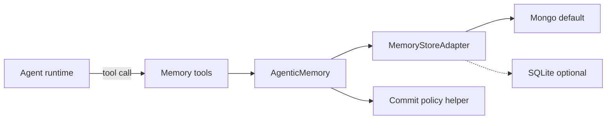

# @util/agentic-memory — Design Plan

## Problem Definition

**Problem:** Agents need durable long-term memory so behavior and knowledge persist across sessions.
**User:** Internal developers building general-purpose agents in the Nexus monorepo.
**Success:** A reusable package that stores/retrieves agent-scoped memories with MongoDB default, pluggable adapters, and production-safe retrieval/update behavior.

## Requirements

### Functional

- Save, retrieve, update (upsert), and delete memory entries.
- Isolate memories by `agentId` so multiple agents do not cross-contaminate experience.
- Support `MemoryType` enum (`preference`, `rule`, `fact`, `context`).
- Expose framework-agnostic tool handlers for LLM tool-calling.
- Provide optional commit-policy helper APIs.

### Non-functional

- Reliability: optimistic concurrency support with `documentVersion`.
- Performance: indexed queries for partition/type/ranking and top-k retrieval.
- Security: caller-bound identity scope (`agentId`) from trusted runtime context.
- Maintainability: storage abstraction via `MemoryStoreAdapter`.

## Architecture

### HLD

### LLD

- Public API:
  - `AgenticMemory.create(config)`
  - `AgenticMemory.getInstance()`
  - `saveMemory(input)`
  - `retrieveMemory(input)`
  - `deleteMemory(input)`
  - `close()`
- Pattern: singleton + factory.
- Storage:
  - `MongoMemoryStoreAdapter` default.
  - Optional `SqliteMemoryStoreAdapter` follow-up.
- Error handling:
  - Not initialized error.
  - Version conflict error for stale updates.

## Phases

### Phase 1 — Foundation

Goal: scaffold package and contracts.
Deliverables:

- `package.json`, `tsconfig.json`
- `types.ts`, `interfaces.ts`, `constants.ts`, `index.ts`
- `docs/plan.md`, `docs/future-roadmap.md`, `README.md`

### Phase 2 — Core Mongo implementation

Goal: deliver default persistence adapter and service integration.
Deliverables:

- `mongo-memory-store.adapter.ts`
- `agentic-memory.ts`
- helper utilities for search and ranking

### Phase 3 — Tooling + policy helpers

Goal: add tool-calling surface and procedural memory helper.
Deliverables:

- `tools/memory-tools.schema.ts`
- `tools/memory-tools.ts`
- `policy/commit-policy.ts`

### Phase 4 — Tests and docs polish

Goal: verify core behaviors and document usage.
Deliverables:

- `agentic-memory.test.ts` (env-gated Mongo integration tests)
- README finalization

## Test Plan

### AgenticMemory lifecycle

- getInstance before create throws
- create initializes singleton
- close clears singleton

### Memory CRUD and retrieval

- save then retrieve by query/type returns expected entry
- delete removes entry
- top-k retrieval returns ranked results

### Isolation and concurrency

- memory written for `agentId=a1` not returned for `agentId=a2`
- stale `expectedDocumentVersion` update throws conflict

### Policy helper

- set commit policy stores a `rule` entry
- decide commit resolves action from stored policy

## Planning Discussion

- Chose Mongo as default because this package targets production multi-agent usage.
- Kept adapter abstraction for framework/storage independence.
- Prioritized procedural memory support first, with semantic/episodic evolution paths.

## Decision Log

- 2026-03-26 — Default adapter is MongoDB; SQLite stays optional follow-up.
- 2026-03-26 — Isolation key is `agentId` for general-purpose agents.
- 2026-03-26 — `MemoryType` is a TypeScript enum to keep explicit and extensible typing.
