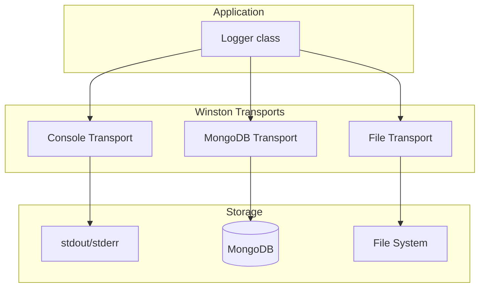

# @util/logger Design Plan

Winston-based multi-transport logger for the Nexus monorepo. Supports Console, File, and MongoDB transports with per-transport levels and child loggers.

## Goal

Build `@util/logger` — a reusable logging package that:

- Uses **Winston** as the core logger (Console and File built-in)
- Supports **MongoDB** as an optional transport
- Allows using **any combination** of transports together
- Configures **per-transport log level** (e.g. `info` for console, `error` for DB)
- Follows Nexus package conventions and design patterns

## Architecture Overview



## Package Structure

```
packages/util-logger/
├── docs/
│   ├── plan.md
│   └── logger-comparison.md   # cau-logger vs aatmix-logger
├── src/
│   ├── helpers/               # Internal helper modules
│   │   ├── build-transports.util.ts
│   │   └── build-transports.util.test.ts
│   ├── transports/
│   │   ├── console.transport.ts
│   │   ├── console.transport.test.ts
│   │   ├── mongodb.transport.ts
│   │   ├── mongodb.transport.test.ts
│   │   ├── file.transport.ts
│   │   └── file.transport.test.ts
│   ├── constants.ts
│   ├── types.ts
│   ├── interfaces.ts
│   ├── logger.ts
│   ├── logger.test.ts
│   └── index.ts
├── test.env
├── package.json
├── tsconfig.json
├── SKILL.md
└── README.md
```

Env is passed from app — no config.ts in package.

## Key Design Decisions

### 1. Main API: Singleton + Factory

- `Logger.create(config)` — initialize with transport config
- `Logger.getInstance()` — get instance (throws if not initialized)
- `Logger.close()` — flush and close connections
- Methods: `trace`, `debug`, `info`, `warn`, `error`, `fatal`, `child(bindings)`
- `level` get/set — read or change minimum log level at runtime
- Default `transports: [{ type: "console" }]` — `create()` works with zero args
- Optional: `context`, `redact`, `timestamp` in LoggerConfig

### 2. Child Loggers

Expose `child(bindings)` for request-scoped context. Returns a new Logger instance with merged bindings.

### 3. Format: Configurable per Transport

| Transport | Default format | Configurable                        |
| --------- | -------------- | ----------------------------------- |
| Console   | `"simple"`     | Yes (`format?: "simple" \| "json"`) |
| File      | `"simple"`     | Yes (`format?: "simple" \| "json"`) |
| MongoDB   | `"json"`       | No (always JSON)                    |

### 4. Transport Configuration (Discriminated Union)

Each transport has `type` and optional `level`. Config types: `ConsoleTransportConfig`, `FileTransportConfig`, `MongoTransportConfig`.

### 5. Optional Peer Dependencies

- **mongodb** — peer (optional) for MongoDB transport

## Env From App

Packages do **not** load environment variables. The app loads env (e.g. dotenv) and passes config values into `Logger.create()`. This keeps packages pure and testable without env side effects.

## Dependencies

| Package         | Type | Purpose           |
| --------------- | ---- | ----------------- |
| winston         | dep  | Core logger       |
| winston-mongodb | dep  | MongoDB transport |

## Usage Example

```typescript
import { Logger } from "@util/logger";

Logger.create({
  defaultMeta: { service: "my-api" },
  transports: [
    { type: "console", level: "debug" },
    {
      type: "mongodb",
      level: "info",
      uri: process.env.MONGODB_URI!,
      collection: "logs",
    },
    {
      type: "file",
      filename: "./logs/app.log",
      format: "json",
      level: "error",
    },
  ],
});

const logger = Logger.getInstance();
logger.info("Started", { port: 3000 });
const reqLogger = logger.child({ requestId: req.id });
await logger.close();
```

## Problem Definition

Every Nexus service needs structured logging with multiple output targets (console, file, MongoDB). Without a shared logger, each service re-invents transport setup, log level management, and metadata handling — leading to inconsistent log formats and duplicated boilerplate. `@util/logger` wraps Winston behind a single factory call that wires transports, levels, redaction, and child loggers automatically.

## Requirements

| #   | Requirement                                             | Status |
| --- | ------------------------------------------------------- | ------ |
| R1  | Singleton + factory pattern (`create` / `getInstance`)  | Done   |
| R2  | Console, File, MongoDB transports (discriminated union) | Done   |
| R3  | Per-transport log levels                                | Done   |
| R4  | Child loggers with merged bindings                      | Done   |
| R5  | Custom levels: trace, debug, info, warn, error, fatal   | Done   |
| R6  | Optional redaction of sensitive paths                   | Done   |
| R7  | Optional timestamp and defaultMeta                      | Done   |
| R8  | Zero-config defaults (console transport, info level)    | Done   |
| R9  | Proper transport flush on `close()`                     | Done   |

## Phases

| Phase | Description                                          | Status    |
| ----- | ---------------------------------------------------- | --------- |
| 1     | Core Logger class + console transport                | Completed |
| 2     | MongoDB + File transports with optional peer deps    | Completed |
| 3     | Child loggers + level get/set                        | Completed |
| 4     | Redaction, timestamp, defaultMeta options            | Completed |
| 5     | Extract redact to helper, DRY log methods, fix close | Completed |
| 6     | Full test coverage + buildRedactFormat unit tests    | Completed |

## Test Plan

### Logger (singleton + lifecycle)

- `create()` returns instance, `getInstance()` returns same
- `getInstance()` throws before `create()`
- `close()` then `create()` reinitializes cleanly
- Zero-config `create()` works

### Log methods

- All 6 levels (trace through fatal) log without throwing
- Logging with and without data metadata

### Child loggers

- `child()` returns a distinct Logger instance
- Child logs without throwing

### Configuration options

- `level` get/set changes minimum log level
- `redact` option masks sensitive fields (tested via buildRedactFormat helper)
- `timestamp: false` accepted without throwing
- `defaultMeta` accepted without throwing

### Transports

- Console transport: simple + json formats, level option
- File transport: creates instance, format and level options
- MongoDB transport: creates instance, default collection
- `buildTransports`: single, multiple, and empty configs

### Integration (env-gated)

- MongoDB transport writes log to collection

## Decision Log

| #   | Question                    | Decision                                                         | Date       |
| --- | --------------------------- | ---------------------------------------------------------------- | ---------- |
| 1   | Winston vs Pino             | Winston — richer transport ecosystem, MongoDB/SQL transports     | --         |
| 2   | Logger optional vs required | Required — app creates and passes it (Nexus convention)          | --         |
| 3   | Peer deps for DB transports | Optional — mongodb is optional peer                              | --         |
| 4   | Custom log levels           | trace/debug/info/warn/error/fatal — matches severity conventions | --         |
| 5   | Redact implementation       | Winston format plugin, extracted to `buildRedactFormat` helper   | 2026-03-17 |
| 6   | Log method DRY              | `createLogMethod` factory function, assigned in constructor      | 2026-03-17 |
| 7   | Transport flush on close    | `winston.end()` + `finish` event instead of no-op                | 2026-03-17 |

## Testing Strategy

- **Unit tests** (co-located): `logger.test.ts`, `console.transport.test.ts`, `file.transport.test.ts`, `build-transports.util.test.ts`, `build-redact-format.util.test.ts`, `mongodb.transport.test.ts` — fast, no external DB
- **Integration tests**: `*.integration.test.ts` — MongoDB with Docker; run via `pnpm test:integration` when env vars set
