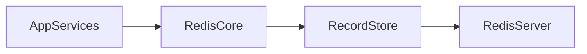

# @util/redis — Design Plan

## Problem Definition

- **Problem:** The repo has no Redis abstraction for generic record storage.
- **User:** Internal backend developers in this monorepo.
- **Success:** A production-ready `@util/redis` package with robust TTL record storage and extension points for future lock/queue capabilities.

## Requirements

### Functional

- Provide a Redis client manager with connection lifecycle (`create/getInstance/close`).
- Provide record storage helpers (set/get/revoke, TTL, namespacing/prefixing, bulk revoke by key family).
- Expose typed APIs from one package entrypoint.

### Non-functional

- Reliability: bounded retries with exponential backoff; connection health checks.
- Performance: low-latency key ops; batching for bulk revocation.
- Security: namespaced keys; avoid secret logging; deterministic key schema.
- Maintainability: vendor details hidden behind package types.

## Architecture

### HLD

### LLD

- Public API:
  - `Redis.create(config): Redis`
  - `Redis.getInstance(): Redis`
  - `Redis.close(): Promise<void>`
  - `RecordStore.setRecord<TValue>(input: SetRecordInput<TValue>): Promise<void>`
  - `RecordStore.getRecord<TValue>(key: string): Promise<Record<TValue> | null>`
  - `RecordStore.revokeRecord(key: string): Promise<void>`
  - `RecordStore.revokeByPrefix(input: RevokeByPrefixInput): Promise<number>`

## Phases

### Phase 1 — Foundation

Goal: Scaffold package structure, key schema constants, and base types.

Deliverables:

- `packages/util-redis` package skeleton (`package.json`, `tsconfig.json`, `src/*`, `docs/*`, `README.md`, `SKILL.md`)

### Phase 2 — Core + Record Storage (Priority)

Goal: Implement Redis lifecycle + TTL record storage with safe bulk revocation.

Deliverables:

- `src/redis.ts` (singleton client lifecycle + retries)
- `src/record-store.ts` (set/get/revoke + prefix revocation)
- `*.test.ts` covering lifecycle and record operations

### Phase 3 — Docs + Integration

Goal: Finalize docs and mark locking/queueing as deferred.

Deliverables:

- Update `README.md` with API table and examples
- Update `docs/future-roadmap.md` with deferred items

## Test Plan

### Redis lifecycle

- `Redis.getInstance()` before `Redis.create()` throws
- `Redis.create()` stores singleton and `Redis.getInstance()` returns same instance
- `Redis.close()` clears singleton and quits connection

### RecordStore

- `setRecord()` then `getRecord()` returns stored record
- `setRecord()` respects TTL (expired record returns `null`)
- `revokeRecord()` deletes record (subsequent `getRecord()` returns `null`)
- `revokeByPrefix()` bulk deletes matching keys

### Failure behavior

- Redis disconnect / unreachable server leads to thrown errors (or skipped tests if env unavailable)

## Planning Discussion

- Key schema: `${keyPrefix}:${recordNamespace}:${key}`; bulk revocation scans by prefix.
- TTL: stored via Redis `PX` using TTL in milliseconds.

## Decision Log

- Chose `redis` npm client and a singleton lifecycle for the connection.
- Deferred distributed locking and queueing to future roadmap.
